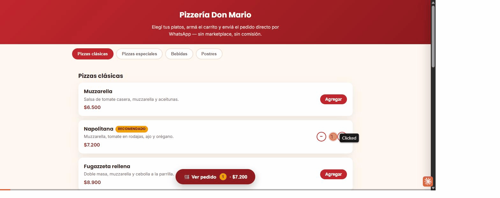

# delivery-online-demo

 

> [!CAUTION]
> **© 2026 Gonzalo Nicolás Bravo — IO Consulting. Todos los derechos reservados.**
>
> Este repositorio es público **solo** para publicar la demo con GitHub Pages. **No es software libre ni de código abierto.** No tenés permiso para copiar, clonar, modificar, redistribuir ni reutilizar este código o sus partes en otros proyectos, personales o comerciales, ni para usarlo en el entrenamiento de modelos de IA. El uso no autorizado infringe la Ley 11.723 de Propiedad Intelectual (Argentina). Condiciones completas en [`LICENSE`](LICENSE). Para pedir permisos: contacto@ioconsulting.com.ar.
>
> **All rights reserved.** This repository is public **only** to serve a GitHub Pages demo. **It is not free or open source software.** You may not copy, clone, modify, redistribute or reuse this code or any part of it in other projects, personal or commercial, or use it to train AI models. Unauthorized use infringes copyright. Full terms in [`LICENSE`](LICENSE). To request permission: contacto@ioconsulting.com.ar.


Catálogo con carrito y pedido online, demo de portfolio de **IO Consulting**. Mismo cliente ficticio que `menu-qr-demo` y `landing-comercio-demo` ("Pizzería IO Consulting"), reusando el mismo `data/menu.json` — es el mismo "motor de catálogo" con un frontend distinto.

## Problema que resuelve

Hoy muchos comercios toman pedidos de delivery por teléfono o WhatsApp manual, escribiendo a mano cada ítem, o pagan comisión a un marketplace (PedidosYa, Rappi) para tener un catálogo online. Este demo arma el pedido en un catálogo con carrito, y lo manda formateado directo al WhatsApp del negocio — sin intermediario ni comisión.

## Demo

`https://ioconsultingarg.github.io/delivery-online-demo/`

Flujo: elegir productos del catálogo (con contador de cantidad) → ver el carrito en el panel lateral → completar datos de entrega y pago → el pedido se abre ya redactado en WhatsApp, listo para enviar.



## Stack

- HTML/CSS/JS puro, sin build step
- Ilustraciones SVG propias y animaciones con [Anime.js](https://animejs.com) v4 (MIT), alojado en el repo: no se carga nada desde CDNs de scripts
- Catálogo cargado desde `data/menu.json` (mismo formato que `menu-qr-demo`)
- Carrito en memoria (`js/catalogo.js` + `js/carrito.js`) — se reinicia al recargar la página, es intencional para esta versión demo
- Mensaje de pedido armado como texto y enviado vía `wa.me` (WhatsApp), sin backend ni servidor de pedidos

## Cómo correrlo local

El catálogo usa `fetch()` para cargar `data/menu.json`, así que no funciona abriendo `index.html` directo desde el explorador de archivos. Levantá un servidor local simple:

```bash
python3 -m http.server 8000
# abrir http://localhost:8000
```

## Qué es real y qué es simulado

- El carrito, el cálculo de total y el armado del mensaje son reales y funcionan del todo en el navegador
- Al confirmar, se abre WhatsApp Web/App con el pedido ya redactado — el envío final lo hace la persona, no es un webhook automático (es intencional: así el dueño no necesita nada corriendo del otro lado para recibir pedidos)
- El pago con Mercado Pago aparece como opción pero deshabilitada ("Próximamente") — la demo no procesa pagos reales; una implementación real usaría Mercado Pago Checkout Pro
- No hay panel de administración de pedidos en esta versión — el "backoffice" del negocio sigue siendo el WhatsApp del local, igual que hoy

## Cómo adaptarlo a otro rubro

1. Reemplazar `data/menu.json` por el catálogo del nuevo negocio (funciona igual para una rotisería, una verdulería con envío, o un catálogo de productos de librería)
2. Cambiar las variables de color en `css/styles.css` (bloque `:root`)
3. Cargar el número de WhatsApp del negocio en `negocio.whatsapp` dentro de `menu.json` (formato internacional sin `+`, ej. `549` + código de área + número). En la demo va vacío a propósito: así WhatsApp deja elegir el destinatario y ningún pedido de prueba le llega a un número ajeno

## Estructura

```
delivery-online-demo/
├── index.html              (catálogo + carrito + checkout)
├── 404.html · sitemap.xml
├── css/styles.css
├── js/catalogo.js          (carga el menú, tarjetas, navegación y carrito)
├── js/carrito.js           (panel lateral: carrito, checkout, mensaje de WhatsApp)
├── js/ilustraciones.js     (dibujos SVG de cada producto)
├── js/animaciones.js       (animaciones, sobre Anime.js)
├── js/vendor/              (Anime.js v4, alojado en el repo)
├── data/menu.json          (mismo catálogo que menu-qr-demo)
├── assets/                 (imagen para compartir y GIF del README)
├── CREDITS.md
├── README.md
└── LICENSE
```

Las animaciones son decorativas: si Anime.js no carga, o la persona tiene activado "reducir movimiento" en su sistema, el sitio funciona igual y sin animar.

## Próximas mejoras posibles

- Integrar Mercado Pago Checkout Pro para cobro online real
- Panel de administración de pedidos (verlos entrar en tiempo real, marcarlos como "en camino"/"entregado")
- Guardar el pedido en Supabase o Google Sheets además de mandarlo por WhatsApp, para tener un historial

---
Parte del portfolio de demos de transformación digital de IO Consulting.
